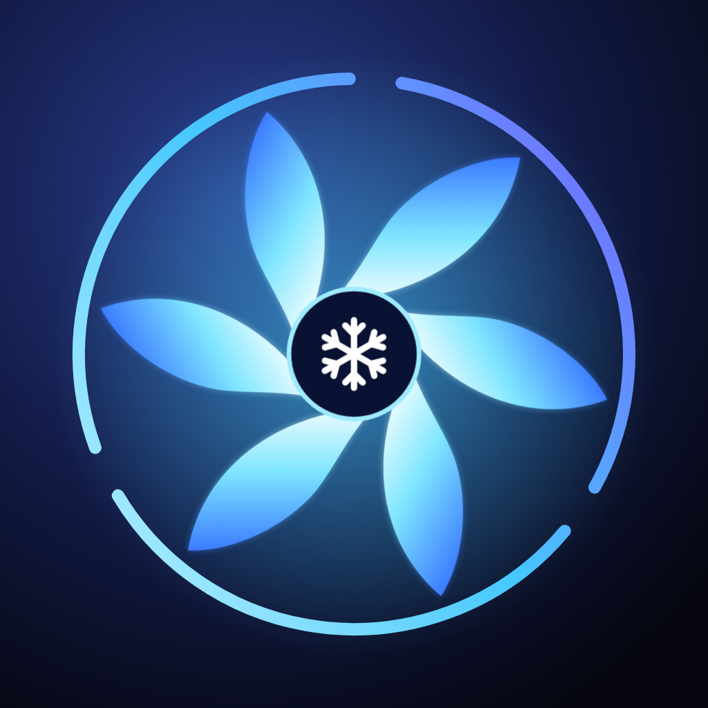

# 極凍 Cryo — 紅魔散熱器 iOS 控制 App



SwiftUI + CoreBluetooth 製作的紅魔散熱器 iOS 控制 App。

專案網址:https://github.com/engnyg/redmagic-ice

## 功能
- 掃描/連線紅魔散熱器、自動重連上次裝置
- 散熱開關、10 檔手動檔位、智慧溫控、破壞神
- 燈光(炫彩 / 多色呼吸 / 單色呼吸 / 常亮 / 關燈 + 15 個預設色)
- 即時溫度、轉速、功率、韌體版本、通訊日誌
- 動態島 / 鎖屏即時動態(Live Activity):緊湊態顯示溫度,展開顯示模式、轉速、功率;連線後自動開啟,「更多」裡可關閉
- 韌體刷寫(Telink OTA,高風險):內建 6 個已知 8 Pro 韌體(見 `Firmware/FIRMWARE_NOTICE.md`),依 SHA-256 辨識,刷前有多重檢查與手動確認
- App 驅動的動態燈效、溫度/檔位/模式聯動燈光、自定義背景(純色/漸變/相簿照片)

## 構建(需 macOS + Xcode 15+)
```
brew install xcodegen
xcodegen generate
open RedMagicIce.xcodeproj
```
在 Signing 中選擇你自己的 Team,把 `PRODUCT_BUNDLE_IDENTIFIER` 改成唯一值,真機執行(模擬器無藍牙)。

> ⚠️ 本倉庫程式碼在 Linux 環境編寫,**尚未編譯/真機測試**;協議來自靜態分析,首次連線請從日誌面板觀察 TX/回包是否符合預期。

## 工具
- `tools/inject_firmware.py`:把已知韌體注入另一份 IPA(Firmware/ 資料夾)。
- `tools/tc32dis.py`:極簡 TC32 反組譯器(指令表來源見檔頭),用來讀 8 Pro 的韌體映像;分析筆記在 `docs/PROTOCOL.md`。
